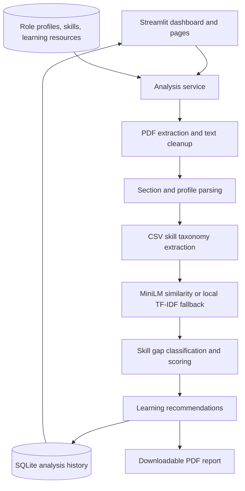

# CareerLens AI

CareerLens AI is a local-first resume and job-fit dashboard. It extracts PDF text, identifies skills from an editable CSV dictionary, compares a resume with a role or pasted job description, classifies skill gaps, scores the match, and suggests learning actions. Results are stored in SQLite and can be downloaded as a PDF report.

## Install and run

From the project directory in PowerShell:

```powershell
py -m venv .venv
.\.venv\Scripts\Activate.ps1
python -m pip install --upgrade pip
python -m pip install -r requirements.txt
python -m streamlit run app.py
```

CareerLens runs without hosted APIs. The sentence-transformers library is installed with the requirements. To enable MiniLM embeddings, download the model once while online:

```powershell
python -c "from huggingface_hub import snapshot_download; print(snapshot_download('sentence-transformers/all-MiniLM-L6-v2'))"
```

The application loads the model with local-only settings. The model download has not been completed in this workspace; if it is not present on your machine, semantic comparisons use a local TF-IDF fallback. Download the model to enable embedding-based semantic similarity. Scanned PDFs produce a warning because OCR is not included.

## Analysis engine

The pipeline returns a structured dictionary containing the analysis ID, compatibility score, score breakdown, semantic method and similarity, profile summary, skill statuses, recommendations, sections, page count, and warnings. Skill status is `matched`, `partial`, or `missing`. The overall score combines required skill coverage (50%), semantic relevance (30%), and rule-based experience/qualification relevance (20%). It is an indicative compatibility measure, not a hiring prediction.

The app calls the modular interfaces in `modules/`: `resume_parser`, `skill_extractor`, `semantic_matcher`, `gap_analyzer`, `scoring_engine`, `recommendation_engine`, `report_generator`, and `database`. The orchestrator in `modules/analysis_service.py` returns one structured result and stores no raw resume text or contact details.

The editable skill dictionary is [data/skills_database.csv](data/skills_database.csv) (102 canonical rows). It uses the columns `skill`, `category`, `aliases`, `related_skills`, and `level`; add skills and aliases there without changing Python. Learning resources are in [data/learning_resources.csv](data/learning_resources.csv) (64 curated skill/resource rows).

## Tests

Run all independent module and end-to-end tests from the project root:

```powershell
python -m unittest discover -s tests -v
```

Each module has its own `tests/test_*.py` script, which can also be run separately, for example `python -m unittest tests.test_resume_parser -v`. The analysis combination tests use generated synthetic PDF resumes, not real candidate resumes. Semantic tests use the local MiniLM model if already cached, otherwise the local TF-IDF fallback.

## Architecture



## GitHub

After creating or choosing a GitHub repository, connect it and push the project from PowerShell:

```powershell
git init
git add .
git commit -m "Build CareerLens AI dashboard"
git remote add origin <your-github-repository-url>
git push -u origin main
```

The local SQLite database and virtual environments are excluded by `.gitignore`.
